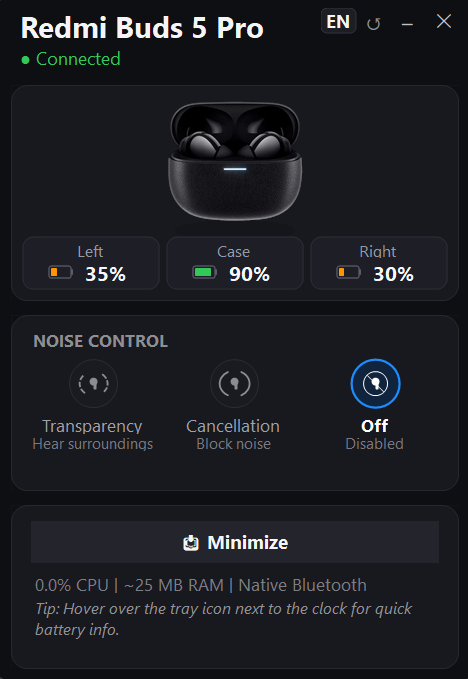
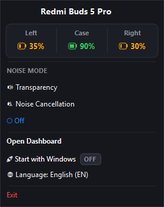

# Mi Earbuddy 🎧

[](https://github.com/Ghost-Faith/MiEarbuddy)
[](https://github.com/Ghost-Faith/MiEarbuddy)
[](https://github.com/Ghost-Faith/MiEarbuddy)
[](LICENSE)

A native, ultra-lightweight Windows desktop companion designed specifically for **Xiaomi & Redmi Earbuds** (including **Redmi Buds 5 Pro**). Inspired by the official **Xiaomi HyperOS Dark Theme** mobile application.

---

## 📸 Preview

<div align="center">
  
  &nbsp;&nbsp;&nbsp;&nbsp;
  
  <p><em>Left: Main HyperOS-inspired Dashboard &nbsp;|&nbsp; Right: Dedicated System Tray Context Menu</em></p>
</div>

---

## ⚡ Performance & Resource Efficiency

- **Zero Bloat**: Standalone single executable written in pure C# (WinForms + GDI+). No Electron, no Node.js, no WebView2, and no Python runtimes.
- **Ultra-Low Memory Footprint**: Uses only **~20 MB to 30 MB** of physical RAM.
- **CPU Idle**: **0.0% CPU** consumption in background and idle states.
- **Native Bluetooth Protocol**: Direct communication using Windows Winsock RFCOMM Sockets (`ws2_32.dll`), reverse-engineered E21 cryptographic challenge authentication, and Google FastPair telemetry.

---

## ✨ Features

### 1. 🔇 Active Noise Cancellation (ANC) Modes
- **Transparency Mode**: Let ambient voices and surrounding sounds in with natural clarity.
- **Noise Cancellation**: Deep active noise suppression.
- **Off Mode**: Standard passive physical isolation.
- **Smart Anti-Bounce Filter**: Prevents audio stutter and suppresses transient dual-earbud sync echoes, ensuring mode transitions are instantaneous with a single clean earbud chime.

### 2. 🔋 Live FastPair Battery Gauges
- **Triple-Cell Monitoring**: Individual battery percentages for **Left Bud**, **Charging Case**, and **Right Bud**.
- **Visual Battery Capsules**: Dynamic color coding (Green >50%, Orange 21–50%, Red ≤20%) and live charging lightning indicator (`⚡`).
- **Graceful Disconnection**: Displays `--` when disconnected, and automatically restores live levels the instant the earbuds reconnect.

### 3. 🎨 Modern HyperOS Dark Design
- **Windows 11 Native Rounded Corners**: Integrated with Desktop Window Manager (`DWMWA_WINDOW_CORNER_PREFERENCE`).
- **Responsive Adaptive Header**: Fluid title and caption controls that automatically adapt without clipping or overlapping buttons on window resizing.
- **Instant Language Toggle**: Seamless one-click switching between English (**EN**) and Portuguese (**PT**).
- **Custom Caption Controls**: Modern Reset Size (`↺`), Minimize (`─`), and Hide to Tray (`✕`) buttons.

### 4. 🚀 System Tray Integration
- **Quick Hover Tooltip**: Hovering over the tray icon next to the Windows clock reveals current earbud model, battery percentages, and active noise mode.
- **Dark Custom Context Menu**:
  - Centered device model title.
  - 3-column battery overview card.
  - Instant noise mode selectors.
  - **Start with Windows** toggle with clear `[ ON ]` / `[ OFF ]` badges.
  - Language toggle and clean exit.

### 5. 🛡️ Single Instance Guard
- Launching the application a second time automatically brings the existing instance to the foreground instead of creating duplicate background processes.

---

## 🚀 How to Run

Download the pre-compiled executable directly from the repository:

```cmd
MiEarbuddy.exe
```

To start minimized directly into the Windows System Tray (e.g. for startup scripts):
```cmd
MiEarbuddy.exe -tray
```

---

## 🔨 How to Build from Source

The repository includes a fast native build script (`build.bat`) that compiles the entire project using Windows' built-in .NET compiler (`csc.exe`) in less than 1 second:

```cmd
build.bat
```

No Visual Studio installation or external package managers are required.

---

## 📁 Repository Structure

```
├── assets/
│   ├── dashboard_preview.png # Application dashboard preview
│   └── tray_preview.png      # System tray context menu preview
├── src/
│   ├── Bluetooth/
│   │   ├── XiaomiAuth.cs     # E21 cryptographic handshake authentication
│   │   └── XiaomiMmaClient.cs# Winsock RFCOMM client, FastPair & XiaoAi protocol
│   ├── Common/
│   │   └── Localization.cs   # Bilingual strings (English / Portuguese)
│   ├── UI/
│   │   ├── EarbudsCaseHeroView.cs # Realistic earbuds case & battery GDI+ rendering
│   │   ├── MainForm.cs       # Main HyperOS dark dashboard form
│   │   └── TrayManager.cs    # System tray icon, tooltip, and custom menu
│   └── Program.cs            # Single-instance mutex & application entry point
├── MiEarbuddy.exe            # Standalone compiled binary
├── build.bat                 # Fast native compiler script
├── case.png                  # High-resolution earbud case asset
├── app.ico                   # Application and tray icon
└── README.md                 # Project documentation
```

---

## 📜 License

This project is licensed under the MIT License - feel free to use, modify, and contribute.

---

## ⚖️ Legal Disclaimer & Trademarks

- **Xiaomi**, **Redmi**, and **HyperOS** are registered trademarks of Xiaomi Inc.
- **Fast Pair** is a trademark of Google LLC.
- **Windows** is a registered trademark of Microsoft Corporation.
- **Mi Earbuddy** is an independent, community-driven open-source project created strictly for hardware interoperability. It is **not** affiliated with, sponsored by, or endorsed by Xiaomi Inc., Google LLC, or Microsoft Corporation.
- All product names, hardware designs, and trademarks mentioned remain the property of their respective owners.

---

## 🛡️ Project Identity & Forking Guidelines

- **Mi Earbuddy** is the official name and brand identity created and maintained by **Ghost-Faith**.
- Community forks, adaptations, and improvements to the source code are fully permitted under the MIT License.
- However, any distributed modified versions or derivative software **must use a distinctly different name, logo, and visual identity** to prevent user confusion with the official Mi Earbuddy application.
- Modified distributions must retain the original copyright notice crediting **Ghost-Faith**.
